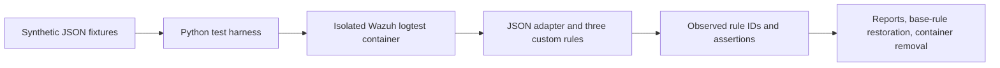

# ATLAS Wazuh Detection Lab — synthetic rule verification

Scope updated 17 October 2026: this is a lab without a user-managed Windows VM. Synthetic data is intentionally used to test real rule-engine behavior. Native Windows collection is an optional future extension, not a prerequisite for the synthetic deliverable.

**Completed synthetic deliverable, 27 October 2026:** automated fresh-container reproduction passed **15/15 cases**, restored the original base rule with a matching SHA-256 hash, and removed its own container. The earlier manually initialized engine run on 16 October also passed 15/15. These are the same 15 scenarios in two runs, not 30 distinct tests.

Inputs are generated fixtures, not collected Windows telemetry. No payload command was executed. Five expected detections and ten negative controls exercise three custom rules in the real Wazuh 4.14.9 logtest engine. [Latest results](evidence/repro-20261027-185423-da963c/summary.json) · [Lifecycle and cleanup](evidence/repro-20261027-185423-da963c-lifecycle/result.json) · [Detection notes and triage](docs/DETECTIONS.md).



| Rule | Behavior | Parent |
|---|---|---|
| 100100 | Failed network logon (4625, type 3, expected provider) | 60122 |
| 100110 | PowerShell/pwsh encoded-command argument | 61603 |
| 100120 | Shortcut created in Windows Startup folder | 61613 |

## Test-only decoder adaptation

`wazuh-logtest` does not reproduce native Windows EventChannel input. Inside the disposable container only, rule 60000 was adapted to accept JSON instead of the ossec/windows_eventchannel gate, retaining level 0. See `scripts/logtest-json-adapter.py` and source/adapted hashes in `evidence/json-adapter.json`. This follows the [Wazuh project discussion](https://github.com/wazuh/wazuh/discussions/25405). The standard file was restored before container removal.

These results validate field matching and rule hierarchy under that adapter. They **do not validate native Windows decoding, agent transport, Sysmon installation, live collection or a full SOC stack**. Do not deploy the adapter to a live manager. The three custom rules still need live guest testing.

## Findings and limitations

The first run reported 15 failures because the harness parsed stdout while logtest emitted results on stderr. Its raw outputs are preserved. It also exposed an unrealistic INFORMATION severity for failed logons and a custom rule attached too high in the hierarchy. The final run uses AUDIT_FAILURE, parent 60122, and checks both output streams plus successful decoding/filtering. A successful process exit alone is insufficient.

Negative controls include successful/interactive logon, missing fields, wrong provider, normal PowerShell, a similar executable name, non-Startup shortcuts and non-shortcut files. A negative control means no ATLAS custom rule fired; built-in rules may fire. These 15 cases are not an exhaustive accuracy or false-positive evaluation. A single failure is not proof of brute force. Encoded commands and Startup shortcuts can be legitimate.

The official manager image was pinned to `wazuh/wazuh-manager:4.14.9@sha256:3561b33f8d1edf3d3b05e1819fa9a47fd28d6536787793d1840bfdf1172359ff`. Only wazuh-db and wazuh-analysisd were started for logtest. The own container had no network, ports or host mounts, with 1 GiB memory, one CPU and no restart. Runtime and cleanup observations are in `evidence/`. No host endpoint settings or user accounts changed. The image remains cached.

## Reproduce the verified run

The automated lifecycle is now implemented in `scripts/run-isolated-lab.py`: check capacity and cached image, create an isolated container, initialize only required services, run tests, restore the base rule, and remove only its own container. Run with Python 3 and a functioning Docker Engine:

```sh
python scripts/run-isolated-lab.py --docker docker
```

The pinned image must already be downloaded; this script does not install Docker or pull images. On Windows, Docker may use WSL2 virtualization internally, while no separate Windows guest is needed. See [Docker's WSL2 backend documentation](https://docs.docker.com/desktop/features/wsl/).

The final automated run on 27 October completed in approximately 27 seconds on the observed host. This is one observation, not a performance guarantee. Python 3.14.7 and Docker Engine 29.7.2 were used. The runner checks at least 2 GiB assigned to Docker and, on Windows, 1.25 GiB available host memory; other hosts need a separate free-memory check. The container is restricted to 1 GiB RAM/swap, one CPU, 256 processes, no network, no published ports, no host mounts, no restart, and no new privileges. Runtime properties are verified before start.

The first 27 October attempt failed before rule tests because the image's initialization script could not be invoked directly. Invoking that vendor script with `/bin/bash` inside the disposable container fixed initialization; the failed container was removed. The 17 October attempt stopped at the memory guard before container creation. Both outcomes remain visible in `evidence/`. The initializer emitted transient `/proc` file-not-found warnings in the successful run; test, restoration and removal results were verified independently. Its "already mounted" messages describe existing internal directories; Docker inspection confirmed an empty mount list.

Evidence includes copied input fixtures and tested rules, one raw logtest output per case, expected/observed IDs, source hashes, adapter hashes and cleanup. [Verification index](evidence/VERIFICATION.md) distinguishes the successful run from earlier failures. Reports are observations, not claims of host protection or personal proficiency.

The synthetic rule-engine scope is complete. Optional later extensions are real Windows/Sysmon collection, agent transport, native EventChannel decoding, dashboard alerts and an end-to-end SOC exercise. None of those is demonstrated here. There is no CI workflow or cloud deployment in this repository.

## References

- [Wazuh logtest](https://documentation.wazuh.com/current/user-manual/reference/tools/wazuh-logtest.html)
- [Custom rule guidance](https://documentation.wazuh.com/current/user-manual/ruleset/rules/custom.html)
- [Container deployment context](https://documentation.wazuh.com/current/deployment-options/docker/wazuh-container.html)

The official image remains an external dependency with its upstream licenses; no vendor image, binary, private key or original vendor rule file is redistributed here. The adapter's original-file hash is recorded without publishing that file.
